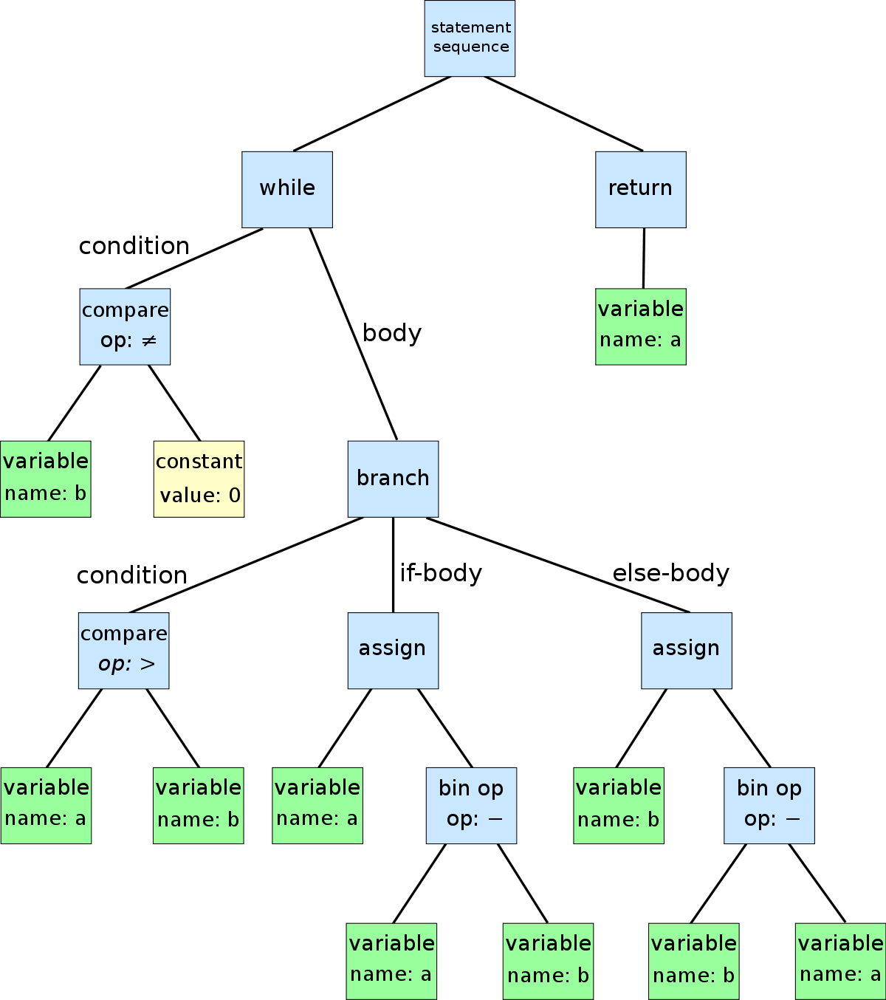
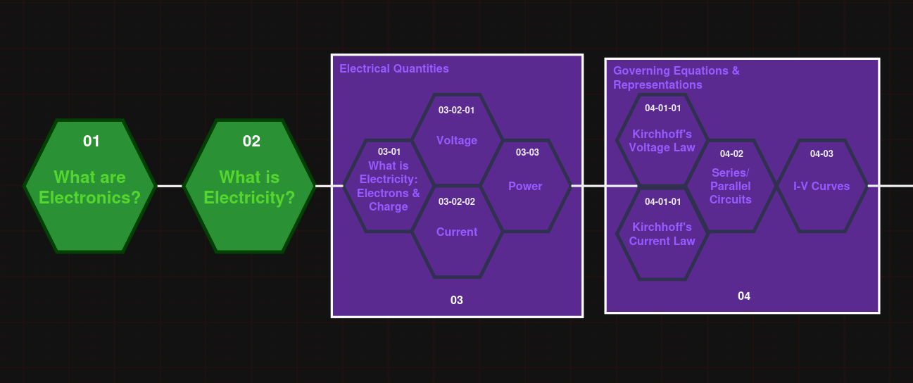
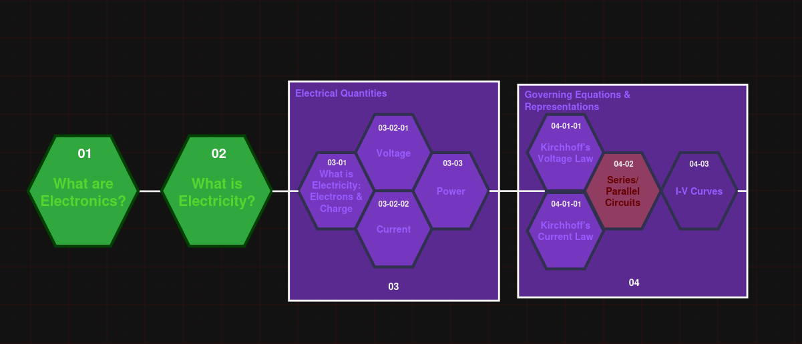

# Skill-Tree Electronics

Welcome to Skill-Tree Electronics! This repository is dedicated to the creation of a novel learning platform to learn anything about electronics from the very basics, to disciplinary-specifics at a professional level.

## Why does this repository exist?
This repository exists because of a fundamental flaw in electronics and electrical engineering education and industry practices.

There are thousands of YouTube videos, written tutorials, technical articles, and applications reports scattered all across the internet. All of which, are free to use. However, there is very few places on the internet that consolidate these resources into an easily accessible format for brand new learners, who aren't already familiar with how to actually find the resources they need to learn.

As comprehensive as they are, textbooks and handbooks on learning electronics aren't free, and readily accessible. Nor are they very streamlined. As much as I'd love to just hand everyone a copy of The Art of Electronics by Paul Horowitz, that just isn't feasible due to copyright law, lol. 

This repository attempts to do something that hasn't been done before, at least within the EE field. Rather than an endless textbook and or video series, this repository aims to mirror a concept pulled from many rpg-style video games called a 'Skill Tree'. 

In these types of games, a skill-tree is a progressive node-network dashboard of skills one can learn from; However, they are restricted from learning any skill they want at any time. In order to gain a specific skill, they must fulfill the prerequisite skills prior to attempting to gain that skill itself. These networks are far from linear. Some skills require multiple pre-requisite skills way before jumping into the next one. Additionally, unlocking a certain skill also has the option of unlocking multiple skills that stem from that single, pre-requisite skill.

This repository intends to adapt the worlds complete knowledge of electrical engineering and electronics design into this skill-tree format. There are just too many subdisciplines and skills in electrical engineering to structure it in any other way. Its impossible to do power electronics well without first learning about electromagnetism, basic signal/frequency responses, PWM, and deeply understanding the mathematical equations of inductors and capacitors. There isn't a single, correct order to learn these prerequisite skills, so making a youtube series about learning electronics or having a textbook to teach one everything, doesn't make any sense. There is no linearity in learning electronics, and there can't be. 

This repository does its best to structure and organize everything you could possibly learn about electronics into a skill-tree format, where any person could simply select the skill they want to learn and be given a pathway to learn it. 

## Where is the content of this project coming from?
The content of the actual lessons of this project will come from online resources that this projects maintainers find to be as detailed and as accurate as possible. Additionally, the hope for this project is that resources from every discipline will come from the recommendation of experiences engineers in that discipline. I.E any lesson on embedded systems should and will be based on resources per the recommendations of an engineer with at least 5 years or more of experience within the embedded systems field.

The origin of these resources will be cited per lesson, so that learners can take advantage of the resources provided to us on their own, if they so choose. We will occasionally adapt textbooks and non-free material, but we will provide their ISBN's and will do our best to teach lessons from them in our own words.

# Dev Notes 
These are just notes I am using to keep track of development, design decisions, and possible problems.

## "Skill Node" Organization Structure

This is the foundation of the skill-tree node model for learning electrical engineering. Pulled form RPG-style games and skill dashboards, the inherent structure is defined by skills requiring some number of prerequisite skills before learning a milestone/skill. 

Nodes in series inherently require its previously chained skill nodes to be completely before moving on with the new skill itself. Nodes in parallel are able to be done in any order and are not dependent on each other for completion. However, these nodes in parallel must both be completed, prior to moving on to the next series node/category node.

It will take very thorough look at the best ways to organize foundational skills into an order that makes sense, but regardless of said order, a skill tree seems to be the most appropriate format for this to take place.

### Determining a path to a skill
Inherently, this structure is an example of a tree in data abstractions:

In summary, a tree network is a collection of nodes, where there is a singular "root" node at the top of the tree. Each valid node has exactly 1 valid parent. Our model will be a tree-node model with un-restricted child nodes. I.E each node can have as many child nodes as it needs. 

The primary differentiator between the proposed skill tree structure and a standard skill tree is the modification of nested nodal prerequisites. In other words, to complete a skill-node in order to move on, a sub-skill-tree contained within a categorical node must be completed prior to being able to mark that categorical node as complete.

**As a visual example:**
In the below diagram, each node has at most 1 parent, but contains its own internal skill-tree that must completed for the overall category to be considered completed. 

Parallel nodes within a categorical node can be thought of as their own categorical grouping of nodes with each parallel node being children of the node

.

As a practical explanation of its use, lets say I want to learn parallel circuits. To get there, I have to first complete the prerequisite parallel nodes that make up kirchhoff's voltage and current laws. Those nodes still have their own prerequisites beyond them. The full path it would take to actually learn about parallel circuits is as follows:

[What are Electronics] -> [What is Electricity] -> [Electrical Quantities] -> ( Incomplete Governing Equations & Representation) -> [Kirchhoff's Voltage Law & Kirchhoff's Current Law] -> [Series/Parallel Circuits]

This flow can be seen in the diagram below. Highlighted nodes below represent the nodes that much be completed before attempting to learn about series/parallel circuits.

## Naming/Numbering Scheme`

### Current Proposed naming scheme

Hierarchical Naming of Skill Nodes:
This skill node naming system consists of an arbitrary length string of integers with dashes in-between, representing category distinctions. Each category or lesson code should have a leading zero.

Ex. The following are all valid naming codes:

* 01, 02
* 01-01, 01-02
* 03-043-0143, 04-011-04

Each number grouping, to reiterate, classifies the category, subcategory, and specific lesson number within its category.

Incrementing integer lessons/skill nodes are dependent on the integer skill-node code before it..

I.E the skill/category 01 must be completed before 02;
01-03, must be completed prior to 01-04,
02-011-06 must be completed prior to 02-011-07.

Below is a visual example of the system:
.

Prior to learning anything in the skill-node-group "03", both 01, and 02 must be completed first in that order. There isn't a restriction that disallows users to skip ahead, but it is recommended that they complete the prior nodes first.

#### Issues with the current system
1.  Doesn't differentiate parallel learning requirements without strict order. For example, voltage and current can be learned without a specific order (Codes "03-02-01" and "03-02-02" a.r.e not dependent on each other, nor have a suggested order of reading). This leaves ambiguity with respect to prerequisites vs arbitrary learning order. 
    - this might not actually be that problematic since, even if a user chose to read in number order, they wouldn't be at a loss. Lessons should try and mirror this behavior, though. And avoid referencing voltage and current in the two documents respectively and should be treated as two independent concepts. Leave the effects on current by voltage for the section on power and IV curves, ideally. 
2. Not directly scalable. This naming scheme does not account for changes we might want to make in the future to the actual learning pathway, if we decide a current ordering is insufficient or impractical.
    * This is honestly a huge draw back and is like the **#1** problem with this model. Will need to think of some alternatives.
